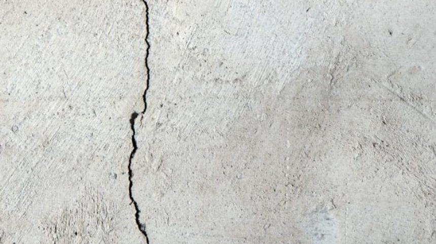
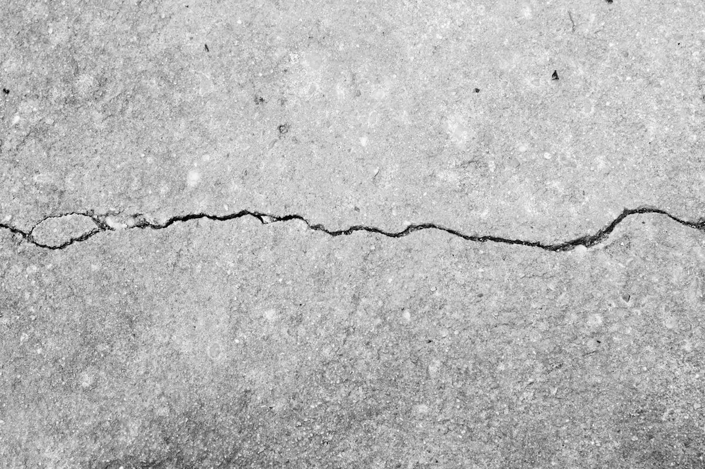
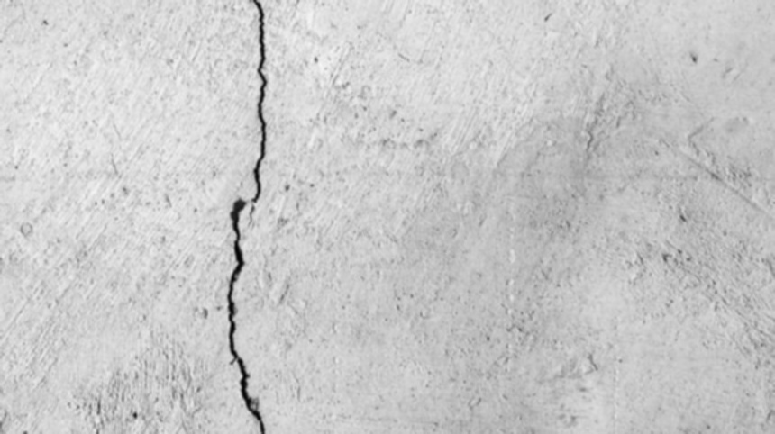
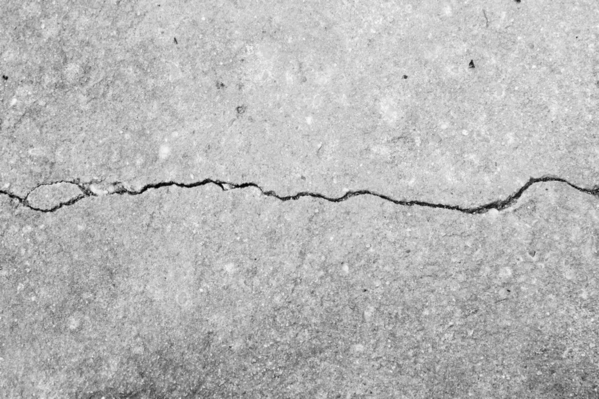
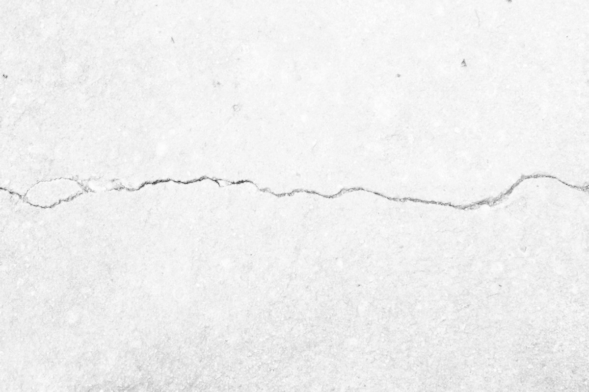
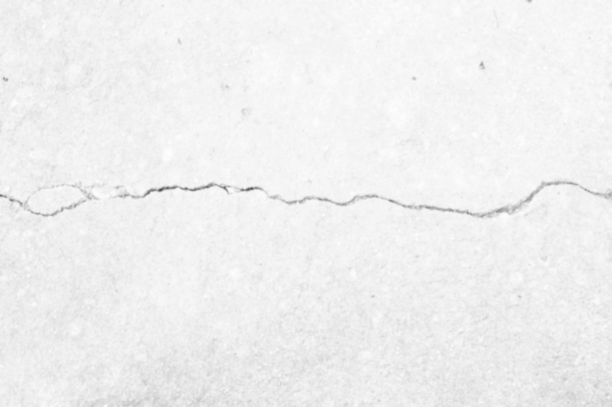
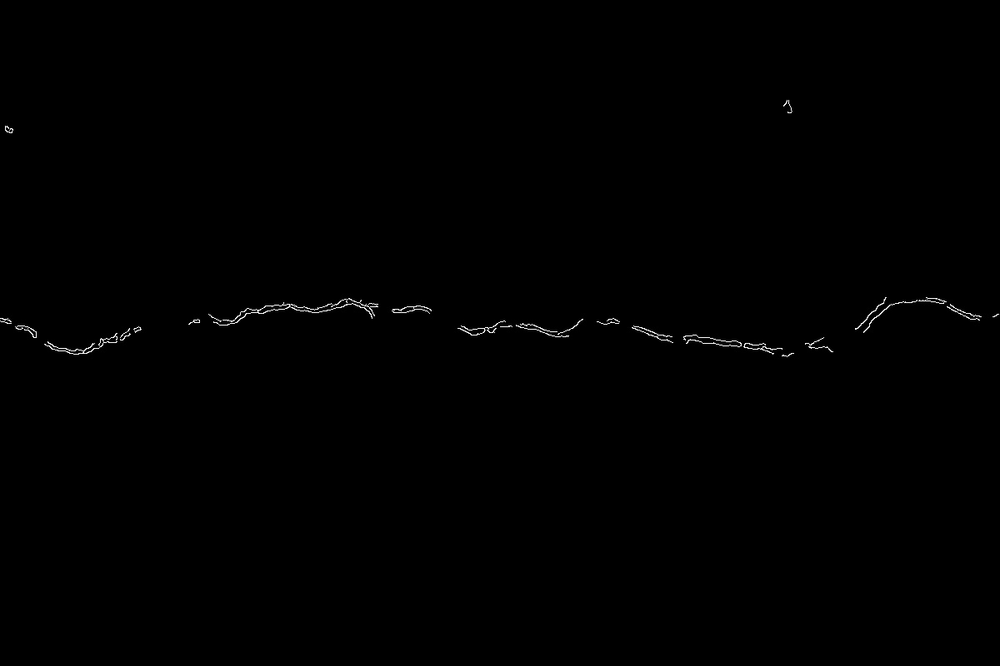
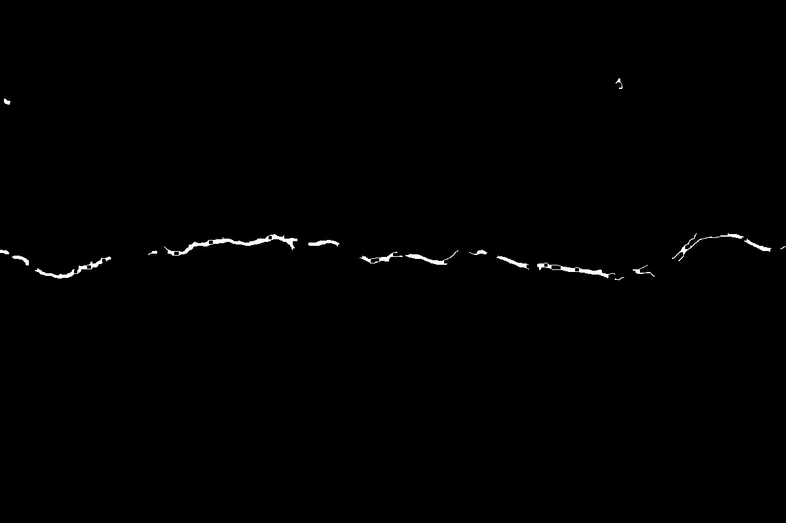
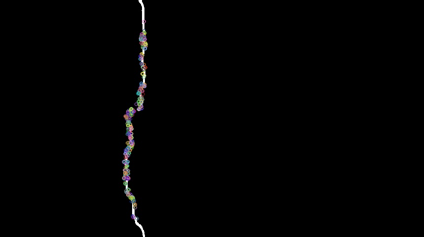
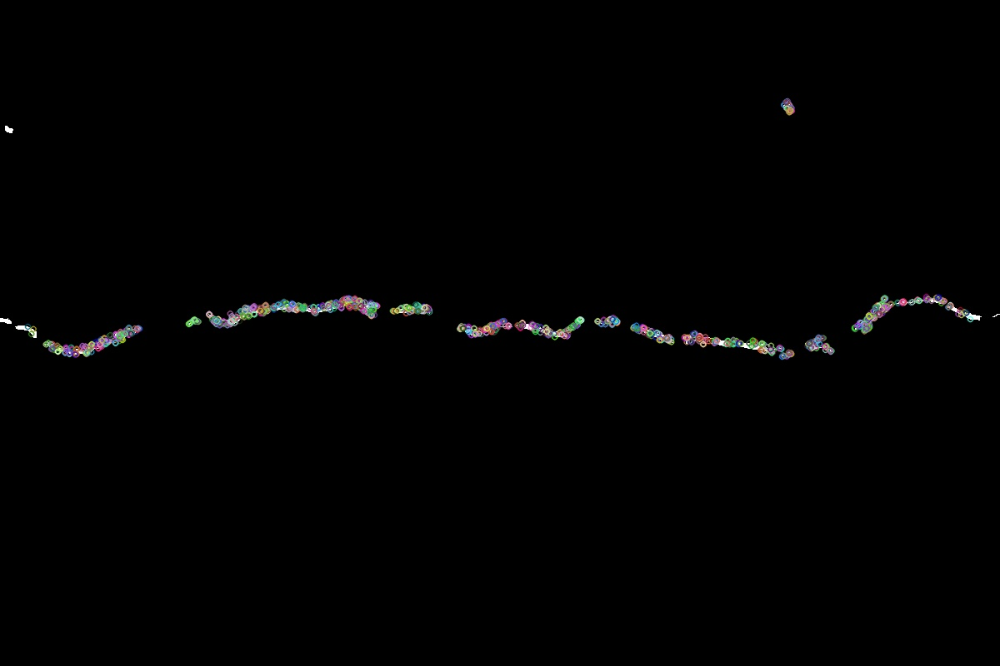

# Road Crack Detection Using OpenCV

## Abstract

Road and concrete infrastructure require regular inspection and maintenance. Detecting cracks early can help reduce maintenance costs and improve road safety. Manual inspection of long highways and other large structures is time-consuming, so image-processing techniques can help identify possible cracks from captured images.

This project demonstrates a traditional computer-vision pipeline for highlighting road cracks. It applies grayscale conversion and blurring, logarithmic intensity transformation, bilateral filtering, Canny edge detection, morphological closing, and ORB feature detection.

The results depend strongly on image quality, lighting, shadows, surface texture, and camera focus. The current implementation is a prototype for crack visualization; further testing is required before using it for safety-critical decisions.

## Introduction

Road cracks and other surface defects can develop because of traffic loads, weather, ageing, and other environmental factors. If they are not identified and repaired in time, they may lead to more extensive deterioration and increase maintenance costs.

Inspecting thousands of kilometres of roads manually can be challenging. An image-based system can help inspectors review road surfaces by processing photographs and highlighting regions that may contain cracks.

The goal of this project is to demonstrate an automated image-processing workflow for detecting crack-like structures in road images.

## Methodology

The image-processing workflow consists of the following stages:

1. Image capture and input.
2. Grayscale conversion and blurring.
3. Logarithmic intensity transformation.
4. Bilateral filtering to smooth the image while preserving edges.
5. Canny edge detection.
6. Morphological closing to join small gaps in detected edges.
7. ORB feature detection and visualization.

### 1. Image Capture

The system takes road-surface photographs as input. Images that are sharp, well-lit, and captured at a suitable angle generally produce more useful results.

The input images used in this project are stored in `Input-Set/`.




### 2. Image Processing Techniques

#### Grayscale Conversion and Blurring

The input image is converted to grayscale so that processing can focus on intensity differences rather than colour. Blurring reduces some high-frequency noise and can make later edge detection more stable.




#### Logarithmic Transformation

Logarithmic transformation changes pixel intensities to expand darker intensity values relative to brighter ones. This can make faint details more visible, although an unsuitable transformation may also hide useful information or amplify noise.




#### Bilateral Filtering

A bilateral filter smooths an image while taking both spatial distance and intensity differences into account. Unlike a simple blur, it can preserve many strong edges while reducing noise.




### 3. Image Segmentation and Edge Detection

#### Canny Edge Detection

The Canny algorithm detects strong intensity changes that may correspond to crack boundaries or other edges. Its main stages are gradient calculation, non-maximum suppression, and double-threshold hysteresis.

Canny detects edges, so not every detected edge is necessarily a crack. Shadows, road markings, and surface texture can also produce responses.




#### Morphological Closing

Morphological closing applies dilation followed by erosion using a structuring element. It can connect nearby edge fragments and fill small gaps in the detected structures.

The effect depends on the structuring element and its size. Closing may also join unrelated edges if the parameters are not appropriate.




### 4. Feature Detection Using ORB

ORB stands for **Oriented FAST and Rotated BRIEF**. It detects keypoints and computes binary descriptors that can be used to describe local image features efficiently.

In this project, ORB is applied to processed images to visualize detected features.

ORB feature detection is not, by itself, a crack classifier. The highlighted keypoints may include features unrelated to cracks, so additional rules or a trained classification or segmentation model would be needed to classify crack types reliably.




## Results and Discussion

The prototype was tried on approximately twenty images containing both cracked and non-cracked road surfaces. In several examples, the processing pipeline made crack-like edges more visible.

However, the results can be affected by poor lighting, shadows, surface patterns, image blur, and other edges that resemble cracks.

The original visual assessment suggested that results could be around 80–90% in favourable conditions. This should be treated as an informal estimate, not a measured model accuracy. A larger labelled test set and a defined evaluation procedure are needed to establish a reliable performance figure.

## Conclusion

This project demonstrates how conventional OpenCV techniques can be combined to highlight possible road cracks in images. Grayscale conversion, logarithmic transformation, bilateral filtering, Canny edge detection, morphological closing, and ORB feature detection each contribute to image preparation, edge extraction, or feature visualization.

The resulting images can support visual inspection and serve as a starting point for a more comprehensive road-condition monitoring system.

The current approach has limitations. It may respond to shadows, road markings, and surface texture, and ORB keypoints do not directly identify or classify cracks.

Future work should test the system on a larger and more varied labelled dataset, tune the image-processing parameters, measure performance using suitable metrics such as precision, recall, and F1-score, and explore crack segmentation or classification models. Reliable quantitative evaluation would be required before deploying such a system in real-world road maintenance or safety-critical applications.

## How to Run

This project can be run locally on Windows, macOS, or Linux. The `CrackDetection.py` script opens a file-selection window so you can choose an image from your computer. It processes the selected image and saves the result in the `Output-Set/` directory.

### Prerequisites

- Python 3
- Git
- Tkinter, generally included with standard Python installations on Windows

### 1. Clone the Repository

Open PowerShell or a terminal and run:

```powershell
git clone https://github.com/Pragyangarg25/Road-Crack-Detection.git
cd Road-Crack-Detection
```

Run the following command to check whether `CrackDetection.py` is present:

```powershell
dir
```

If the file is inside another folder named `Road-Crack-Detection`, enter that folder:

```powershell
cd Road-Crack-Detection
```

Run the remaining commands from the directory containing `CrackDetection.py`.

### 2. Create a Virtual Environment

For Windows PowerShell:

```powershell
python -m venv .venv
.venv\Scripts\Activate.ps1
```

For macOS or Linux:

```bash
python3 -m venv .venv
source .venv/bin/activate
```

If PowerShell blocks virtual environment activation, you can run the program using the virtual environment's Python executable directly.

### 3. Install Dependencies

With the virtual environment activated, run:

```powershell
python -m pip install --upgrade pip
python -m pip install numpy opencv-python matplotlib
```

The program uses Python's `tkinter.filedialog` to select images. Tkinter is generally included with standard Windows Python installations.

**Note:** Do not import `google.colab` when running locally. That library is intended for Google Colab notebooks, whereas this project uses Tkinter for local image selection.

### 4. Run the Program

Execute:

```powershell
python CrackDetection.py
```

A file-selection window will open.

1. Select an image from your computer.
2. Click Open.
3. Allow the program to process the image.
4. View the original and processed images displayed by Matplotlib.

Supported image formats include JPG, JPEG, PNG, BMP, TIF, and TIFF, subject to OpenCV support.

### 5. View the Output

The program saves the generated output in the `Output-Set/` directory. The directory is created automatically if it does not already exist.

For example:

```text
Output-Set/
└── CrackDetected_yourimage.jpg
```

The output filename is generated from the selected input image's name.

### Troubleshooting

- **`ModuleNotFoundError`:** Activate `.venv` and install the required dependencies.
- **`No module named 'google.colab'`:** Remove `from google.colab import files` and use the Tkinter image-selection code.
- **No file-selection window appears:** Ensure that you are running the script in a desktop environment and that Tkinter is available.
- **The output looks different for different images:** Results depend on lighting, shadows, image quality, surface texture, and processing parameters.
- **Some keypoints are not on cracks:** ORB detects local image features; it does not independently classify every detected feature as a crack.

## References

1. M. Ann and P. Johnson, *Best Practices Handbook on Asphalt Pavement Maintenance*, Minnesota Technology Transfer (T2) Center / LTAP Program (2000). [PDF](http://www.cee.mtu.edu/~balkire/CE5403/AsphaltPaveMaint.pdf).

2. T. D. Donald Walker, *Pavement Surface Evaluation and Rating (PASER) Manuals*, Wisconsin Transportation Information Center (2002). [PDF](http://www.apa-mi.org/docs/Asphalt-PASERManual.pdf).

3. R. K. Kay, *Pavement Surface Condition - Rating Manual*, Northwest Technology Transfer Center, Washington State Department of Transportation (1992).

4. L. Li, L. Sun, G. Ning, and S. Tan, "Automatic pavement crack recognition based on BP neural network," *PROMET - Traffic & Transportation*, 26(1), 11–22 (2014).

5. National Highway Traffic Safety Administration (NHTSA), *National Motor Vehicle Crash Causation Survey Report to Congress* (2008). [Report](http://www-nrd.nhtsa.dot.gov/Pubs/811059.PDF).

6. J. M. Palomares, J. González, and E. Ros, "Detección de bordes en imágenes con sombras mediante LIP–Canny," AERFAI Symposium on Pattern Recognition and Image Analysis, Granada (2005).

7. J. S. Miller, R. B. Rogers, and G. R. Rada, "Appendix A - Pavement Distress Types and Causes," in *Distress Identification Manual for the Long-Term Pavement Performance Project*, National Cooperative Highway Research Program (1993), pp. 1–31.
7. JS Miller, RB Rogers, GR Rada, in Distress Identification Manual for the Long-Term Pavement Performance Project. Appendiz A - Pavement Distress Types and Causes (National Cooperative Highway Research Program, At NW Washington, 1993), pp. 1–31.
